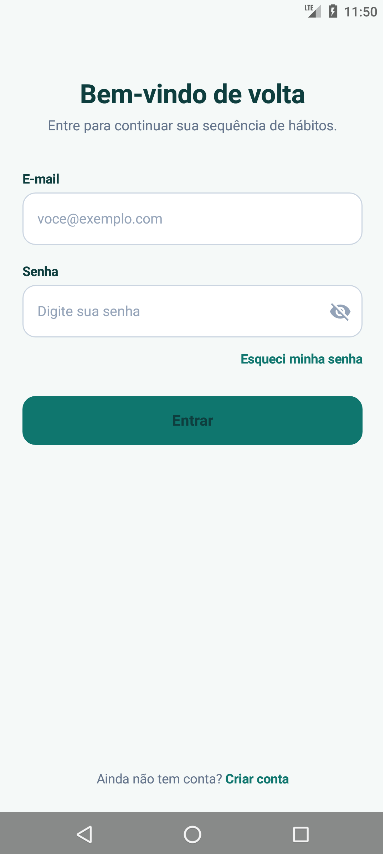
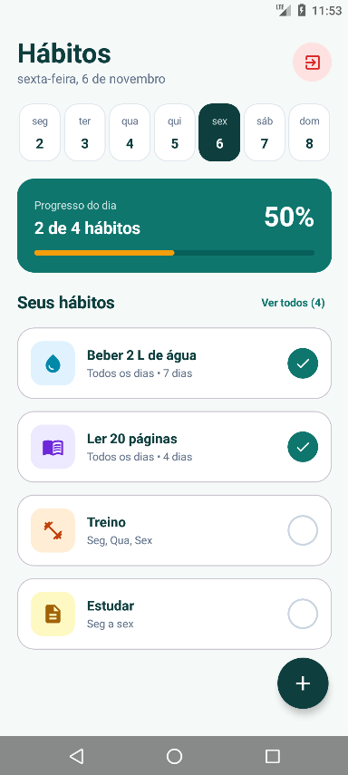

# 📅 Aplicativo de Controle de Hábitos (Habit Tracker)

Aplicativo móvel moderno e interativo para gerenciamento e acompanhamento de hábitos diários, desenvolvido em **Kotlin** com **Jetpack Compose** para Android. O projeto foi construído a partir de um protótipo desenhado no **Figma**, utilizando a arquitetura **MVVM (Model-View-ViewModel)**, integração com **Firebase Authentication** para autenticação de usuários e persistência local com **SharedPreferences**.




---

## ✨ Funcionalidades

- 🔐 **Autenticação com Firebase:** Sistema completo de cadastro de nova conta, login com e-mail/senha e recuperação de senha, com validação de campos e mensagens de feedback em tempo real.
- 📆 **Calendário Semanal Interativo:** Barra horizontal no topo permitindo navegar rapidamente entre os dias da semana atual.
- 🎯 **Filtragem Inteligente por Dia da Semana:** Os hábitos aparecem estritamente nos dias configurados para sua repetição (ex.: apenas segundas, terças e sextas), permitindo também alternar para visualizar todos os hábitos cadastrados.
- 📊 **Progresso Diário Reativo:** Card de destaque com contagem (_"X de Y hábitos"_), porcentagem e barra de progresso animada com design e cores fiéis ao protótipo do Figma.
- 📈 **Estatísticas e Histórico de 14 Dias:** Tela de detalhes completa exibindo a sequência atual (_streak_), melhor sequência histórica, taxa percentual de conclusão e grade visual interativa dos últimos 14 dias (Feito, Perdido e Hoje).
- ✏️ **Criação e Edição de Hábitos:** Formulário completo para definir nome, descrição opcional, paleta de 5 cores do Figma, seletor circular dos dias da semana (S, T, Q, Q, S, S, D), switch de lembrete diário e seletor de horário com `TimePickerDialog`.
- 💾 **Persistência Local Offline:** Gerenciamento reativo de estado com `StateFlow` e armazenamento local em `SharedPreferences` com serialização JSON via Gson, mantendo os dados preservados ao fechar o aplicativo.
- 🎨 **Interface Moderna e Declarativa:** Construída 100% em Jetpack Compose com Material 3, tipografia personalizada e design system baseado nas cores verde petróleo (#0F766E), fundo suave (#F5F9F8) e acentos em amarelo (#F59E0B).

---

## 🛠️ Tecnologias Utilizadas

- **Linguagem:** [Kotlin](https://kotlinlang.org/)
- **IDE:** [Android Studio](https://developer.android.com/studio)
- **Toolkit de UI:** [Jetpack Compose](https://developer.android.com/jetpack/compose) (Material 3)
- **Arquitetura:** MVVM (Model-View-ViewModel) + Repository Pattern
- **Autenticação:** [Firebase Authentication](https://firebase.google.com/docs/auth)
- **Navegação:** [Jetpack Navigation Compose](https://developer.android.com/guide/navigation/navigation-compose)
- **Gerenciamento de Estado:** Coroutines, `StateFlow` e `AndroidViewModel`
- **Persistência Local:** SharedPreferences & [Gson](https://github.com/google/gson)
- **Design:** [Figma](https://www.figma.com/design/7ogRdN1OcMBp0Ax8ti73iW/Aplicativo-de-Controle-de-Hábitos)

---

## 📂 Estrutura do Projeto

```text
├── app/
│   ├── src/main/
│   │   ├── java/dev/raul/aplicativodecontroledehabitos/
│   │   │   ├── auth/                                    # Autenticação (Firebase Auth)
│   │   │   │   ├── AuthState.kt                         # Estado reativo da sessão e validações
│   │   │   │   └── AuthViewModel.kt                     # Regras de autenticação (entrar, registrar, recuperar, sair)
│   │   │   ├── habitos/                                 # Lógica e ViewModel de Hábitos
│   │   │   │   ├── HabitoEstado.kt                      # Estado reativo da UI (hábitos do dia, progresso)
│   │   │   │   └── HabitoViewModel.kt                   # ViewModel responsável pelas regras de hábitos
│   │   │   ├── dados/                                   # Camada de Dados
│   │   │   │   ├── modelo/                              # Entidades e Modelos de Domínio
│   │   │   │   │   ├── Habito.kt                        # Modelo principal do Hábito
│   │   │   │   │   ├── CorHabito.kt                     # Paleta de 5 cores do Figma
│   │   │   │   │   ├── OpcaoDiaSemana.kt                # Dias da semana (S, T, Q, Q, S, S, D)
│   │   │   │   │   └── StatusDia.kt                     # Status dos dias e dias do calendário
│   │   │   │   ├── local/                               # Persistência Local
│   │   │   │   │   └── PreferenciaHabitos.kt            # SharedPreferences com serialização JSON
│   │   │   │   └── repositorio/                         # Repositórios
│   │   │   │       ├── RepositorioAuth.kt               # Repositório do Firebase Auth
│   │   │   │       └── RepositorioHabitos.kt            # Repositório de hábitos observável
│   │   │   ├── navigation/                              # Navegação
│   │   │   │   └── AppNavigation.kt                     # Rotas centralizadas no object Rotas
│   │   │   ├── ui/                                      # Interface do Usuário (Jetpack Compose)
│   │   │   │   ├── telas/                               # Telas principais
│   │   │   │   │   ├── Login.kt                         # Tela "Bem-vindo de volta"
│   │   │   │   │   ├── Registrar.kt                     # Tela "Crie sua conta"
│   │   │   │   │   ├── EsqueceuASenha.kt                # Tela "Esqueceu sua senha?"
│   │   │   │   │   ├── ListaHabitos.kt                  # Tela "Hoje" / Lista de hábitos
│   │   │   │   │   ├── DetalhesHabito.kt                # Tela "Detalhes" com métricas e 14 dias
│   │   │   │   │   └── FormularioHabito.kt              # Tela de cadastro e edição de hábitos
│   │   │   │   ├── componentes/                         # Componentes reutilizáveis
│   │   │   │   │   ├── CampoTexto.kt                    # Campo de texto customizado
│   │   │   │   │   ├── BotaoPrincipal.kt                # Botão com loading
│   │   │   │   │   ├── CardHabito.kt                    # Card com ícone e toggle de conclusão
│   │   │   │   │   ├── IconeHabito.kt                   # Ícone dinâmico com cor de fundo
│   │   │   │   │   ├── BarraProgressoHabito.kt          # Card de progresso do dia
│   │   │   │   │   ├── BarraSemanal.kt                  # Barra de calendário semanal
│   │   │   │   │   ├── SeletorCor.kt                    # Seletor de cores da paleta
│   │   │   │   │   └── SeletorDias.kt                   # Seletor de dias da semana
│   │   │   │   └── theme/                               # Design System
│   │   │   │       ├── Color.kt                         # Cores oficiais do Figma
│   │   │   │       ├── Theme.kt                         # Configuração do MaterialTheme
│   │   │   │       └── Type.kt                          # Tipografia
│   │   │   ├── util/                                    # Utilitários
│   │   │   │   └── UtilitarioData.kt                    # Cálculos de datas, streaks e conclusões
│   │   │   └── MainActivity.kt                          # Activity principal
│   │   ├── google-services.json                         # Configuração do Firebase
│   │   └── AndroidManifest.xml
│   └── build.gradle.kts
└── build.gradle.kts
```

---

## 🚀 Como Executar o Projeto

1. **Clone este repositório:**

   ```bash
   git clone https://github.com/Raul-Brasiel/Mobile-Device-Programming.git
   ```

2. **Abra no Android Studio:**
   - Abra o Android Studio.
   - Selecione **Open** e navegue até a pasta `Aplicativo de Controle de Habitos`.
   - Aguarde o Gradle sincronizar as dependências.

3. **Configuração do Firebase:**
   - Certifique-se de que o arquivo `google-services.json` válido do seu projeto Firebase esteja presente no diretório `app/`.
   - Habilite a autenticação por **E-mail/Senha** no console do Firebase.

4. **Execute no Emulador ou Dispositivo Físico:**
   - Conecte seu aparelho via USB (com Depuração USB ativada) ou inicie um emulador (AVD).
   - Clique no botão **Run** (`Shift + F10` ou o ícone verde ▶️).

---

## 👨‍💻 Autor

Desenvolvido por **Raul**.